# 추억을 저장하는 타임캡슐

차로 다녀온 곳마다 기억을 남기고, 그곳에 다시 가면 차가 먼저 꺼내 주는 Pleos Connect 차량용 앱입니다. (프로토타입)

현대자동차그룹 차량용 앱 개발 공모전 출품작 · 팀 AROK

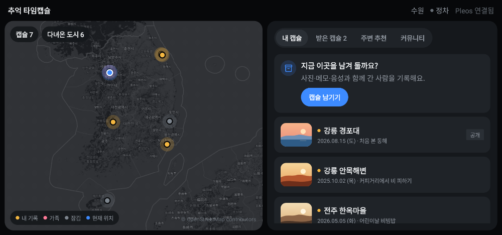

## 앱 한 줄 소개

차가 기억하는 우리의 장소들: 위치·주행 데이터로 남기고 여는 가족 타임캡슐

## 주요 기능

| 기능 | 설명 | 차량에서만 되는 부분 |
| --- | --- | --- |
| 타임캡슐 기록 | 다녀온 곳에 사진·메모·음성을 날짜·시간·함께 간 사람과 저장 | 내비 목적지에 도착하면 기록 제안, 함께 탄 인원·주행 거리·비 온 날 자동 첨부, 운전 중에는 음성만 |
| 다시 지나가면 | 기록이 있는 도시에 다시 들어가면 그곳 기억을 모아 보여줌 (거주 도시 제외) | 위치로 도시 진입을 감지, 운전 중에는 음성 안내, 정차하면 화면 |
| 조건부 캡슐 | 연도(필수)·월·일(선택)과 장소 조건이 모두 맞아야 열림 | 차가 그 장소에 도착한 순간 열림 (지오펜스) |
| 가족에게 보내기 | 저장 후 "가족에게 전달하시겠어요?" 제안, 받은 캡슐 보관함 | 보낸 사람이 장소 조건을 걸면 그곳에서 열림 |
| 주변 추천 | 현지 핫플(많은 사람이 목적지로 고른 곳)·주차장·드라이브스루 | 바로 내비 경유지로 추가 |
| 커뮤니티 | 공개한 캡슐만 보이는 피드, 공감만 가능 | 다른 사람이 다녀온 곳을 경유지로 추가 |

## 화면

| | |
| --- | --- |
| 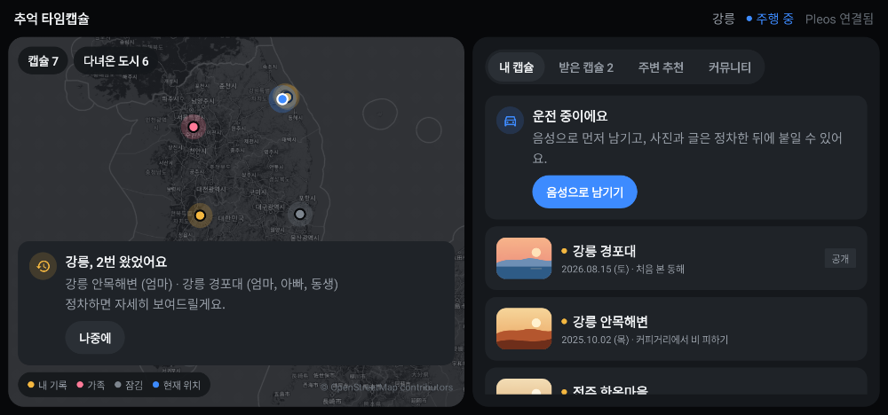 주행 중 강릉에 들어오면 예전 기억을 음성과 함께 안내 | 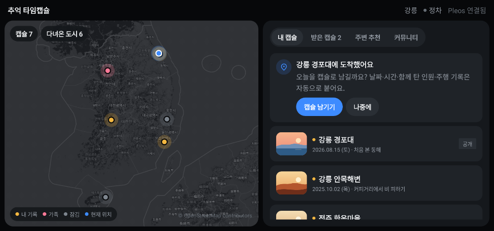 내비 목적지 도착 → 기록 제안 |
| 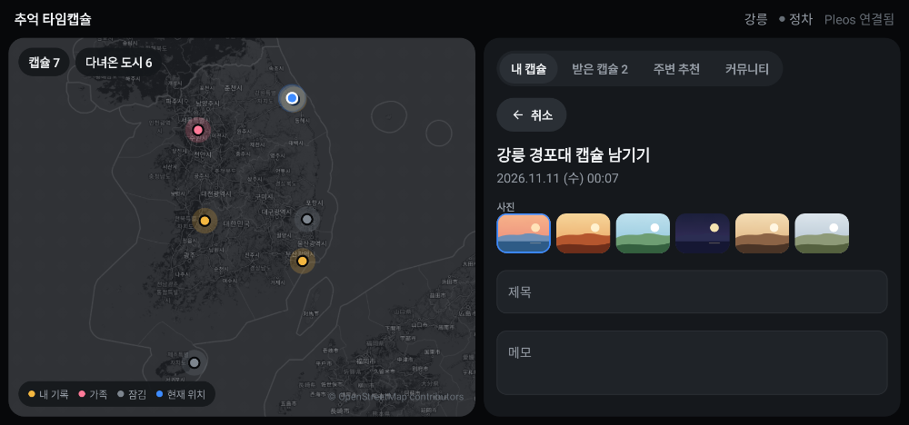 사진·메모·음성, 함께 간 사람, 조건부 캡슐 | 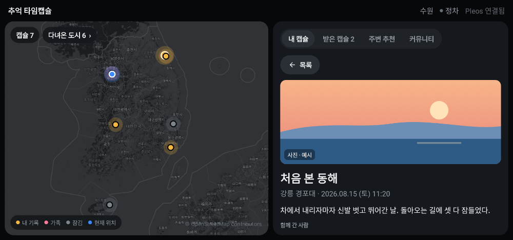 그날의 차 기록이 함께 남은 캡슐 |
| 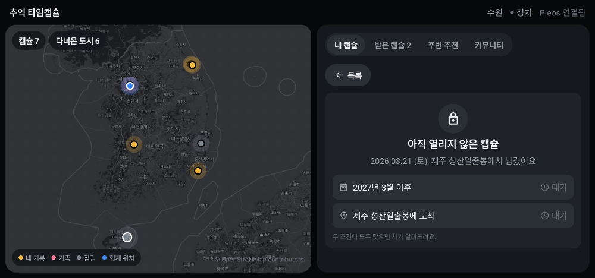 날짜와 장소 조건이 모두 맞아야 열림 | 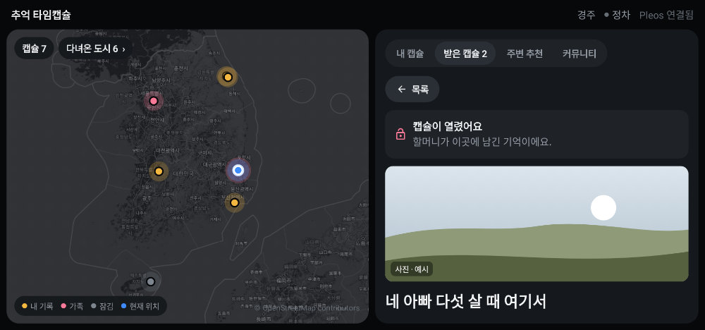 할머니가 남긴 캡슐이 그 장소에서 열림 |
| 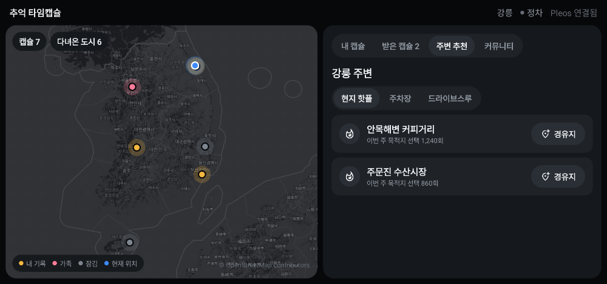 핫플·주차장·드라이브스루 → 경유지 | 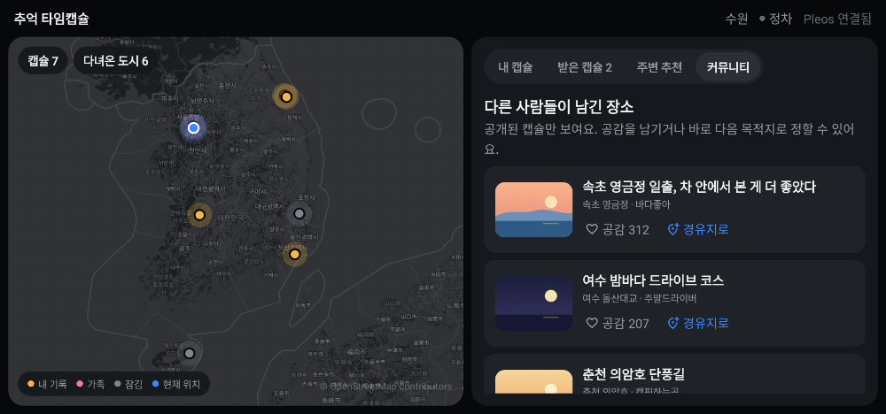 공개된 캡슐 피드 |

### 세로 화면

폰이나 Pleos 분할 화면의 좁은 칸에서는 지도가 위, 목록이 아래로 바뀝니다.

| | | |
| --- | --- | --- |
| 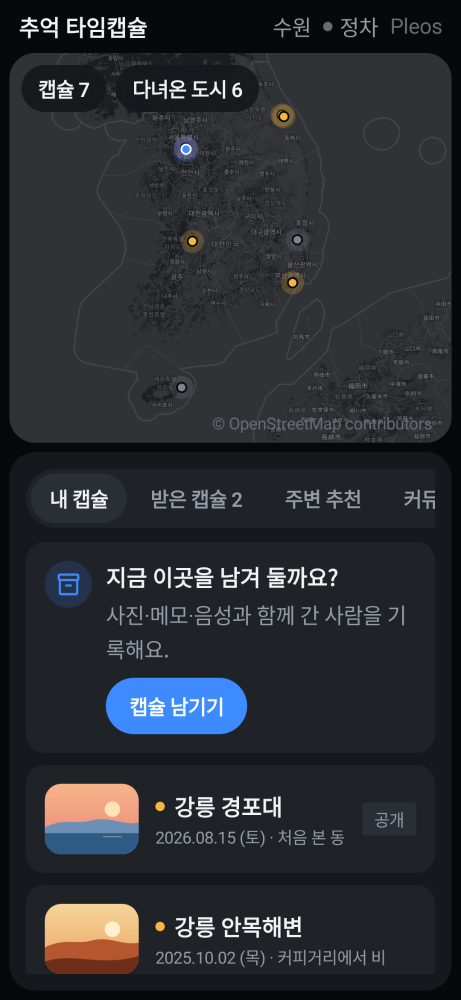 | 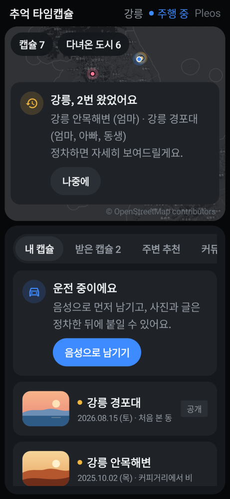 | 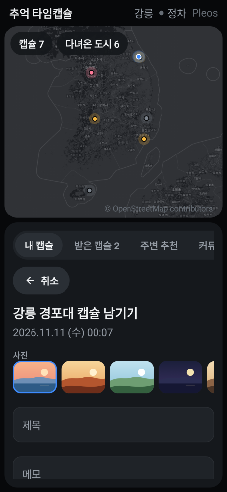 |

## APK 파일 위치

- 저장소: [`apk/AROK_추억을저장하는타임캡슐_release.apk`](apk/AROK_추억을저장하는타임캡슐_release.apk) (release 빌드, 18MB)
- GitHub Release: [v0.1.0](https://github.com/kjj021207-alt/arok-timecapsule/releases/tag/v0.1.0)

## 실행 방법

### APK로 바로 실행

1. 위 APK 파일을 내려받습니다.
2. Pleos Connect Emulator(또는 안드로이드 기기)를 켜고 APK를 화면에 끌어다 놓거나 아래 명령으로 설치합니다.

```bash
adb install apk/AROK_추억을저장하는타임캡슐_release.apk
```

처음 실행하면 위치(Pleos FusedLocation)와 마이크 권한을 요청합니다.

### 소스에서 빌드

1. Android Studio에서 **File → New → Project from Version Control**로 이 저장소를 엽니다.
2. Gradle 동기화가 끝나면 실행 대상을 Pleos Connect Emulator로 고르고 Run을 누릅니다.

```bash
./gradlew assembleRelease
```

결과물은 `app/build/outputs/apk/release/app-release.apk`입니다.

## 테스트 환경 및 필요한 설정

| 항목 | 버전 |
| --- | --- |
| JDK | 17 |
| Gradle / Android Gradle Plugin | 8.7 / 8.5.2 |
| Kotlin / Compose BOM | 2.0.20 / 2024.09.02 |
| minSdk / targetSdk | 28 / 34 |
| Pleos Connect Emulator | v2.1.0 (Android API 34, Automotive) |

- **Pleos Connect Emulator 설치**: [Pleos 개발 문서](https://document.pleos.ai/docs/connect/guide/getting-started/application-development/setup-connect-sdk-emulator)
- **차량 상태 바꾸기**: 에뮬레이터 실행 후 `adb forward tcp:8088 tcp:8088`을 입력하고 브라우저에서 `http://127.0.0.1:8088/`(Pleos Connect Virtual Console)을 엽니다. 문 열림, 와이퍼 등을 바꿔 볼 수 있습니다.
- **지도**: OpenStreetMap(osmdroid)을 써서 API 키가 필요 없습니다. 인터넷 연결만 있으면 됩니다.
- **음성 인식 키 (선택)**: Pleos Playground 프로젝트의 Client ID/Secret을 `local.properties`에 넣으면 음성 인식이 서버(HYBRID) 모드로 동작합니다. 비워 두면 기기 내장(ON_DEVICE) 모드로 동작합니다. `local.properties`는 저장소에 올라가지 않습니다.

```properties
pleos.clientId=발급받은_ID
pleos.clientSecret=발급받은_SECRET
```

### 데모 모드

Pleos 차량 서비스가 없는 기기(일반 폰·태블릿, 일반 에뮬레이터)에서는 자동으로 **데모 모드**로 실행됩니다.
오른쪽 패널 아래의 데모 시나리오("강릉으로 주행 중", "강릉 경포대 도착", "경주 대릉원 도착" 등)를 누르면 차량 신호를 흉내 냅니다.

## Pleos Connect SDK 사용

| SDK | 쓰는 API | 용도 |
| --- | --- | --- |
| FusedLocation 1.1.3 | `registerFusedLocationCallback`, `addProximityAlert` | 현재 위치, 도시 진입 판단, 잠긴 캡슐 장소 도착 감지 |
| NaviHelper 3.0.5 | `onDestinationInfo`, `onDestinationArrived`, `onNavigationStatus`, `addWaypoint` | 목적지 도착 시 기록 제안, 주행 중 여부, 추천 장소 경유지 추가 |
| Vehicle 2.3.2 | `Door.registerDoorPosition`, `Wiper.registerWiperState`, `Odometer.getTripCurrentDrivingDistance/Time` | 함께 탄 인원, 비 온 날, 주행 거리·시간 |
| TextToSpeech 3.3.1 | `speak` (ON_DEVICE) | "강릉, 2번 왔었어요" 같은 음성 안내, 캡슐 읽어주기 |
| SpeechToText 3.3.1 | `request` / `sendAudio` | 운전 중 음성 메모 |

기록 제안은 팀 결정에 따라 **기어(P/D)를 쓰지 않습니다.** 내비 목적지 도착 이벤트로 제안하고, 그 밖에는 앱의 "캡슐 남기기" 버튼으로 언제든 기록할 수 있습니다.

## 구조

```
app/src/main/java/com/arok/timecapsule/
├── car/                 차량 신호 (CarSignals 인터페이스)
│   ├── pleos/           Pleos Connect SDK 연결 (PleosCarSignals, PleosSpeech)
│   └── DemoCarSignals   Pleos가 없는 기기용 데모 신호
├── data/                Room DB, 저장소, 예시 데이터
├── domain/              팀이 정한 규칙 (열림 조건, 도시 진입, 기록 제안)
└── ui/                  Jetpack Compose 화면 (지도, 패널, 테마)
```

화면과 규칙 코드는 `CarSignals` 인터페이스만 사용하므로, 실제 차량과 데모 모드에서 똑같이 동작합니다.

### 스크린샷 다시 만들기

에뮬레이터 없이 화면을 이미지로 렌더링합니다 (Paparazzi). 결과는 `app/src/test/snapshots/images/`에 생깁니다.

```bash
./gradlew recordPaparazziDebug
```

Windows에서 프로젝트 경로에 한글이 있으면 테스트 실행기가 클래스를 찾지 못하므로, 영문 경로에 복사해서 실행하세요.

## 프로토타입 범위

- 사진은 차량에 카메라 API가 없어 예시 일러스트로 대신합니다. 실제 서비스는 휴대폰에서 사진을 올리는 방식입니다.
- 가족 전송·커뮤니티·주변 추천은 화면과 흐름까지 구현했고, 서버 연동(Firebase)은 2차 PT 전까지 진행합니다.
- 캡슐 데이터는 기기 안의 Room DB에 저장됩니다.
- 이 저장소의 빌드와 화면 렌더링은 확인했지만, Pleos Connect Emulator에서의 실제 실행 확인은 팀원 PC에서 진행합니다.

## 출처

- 지도 데이터: © OpenStreetMap contributors
